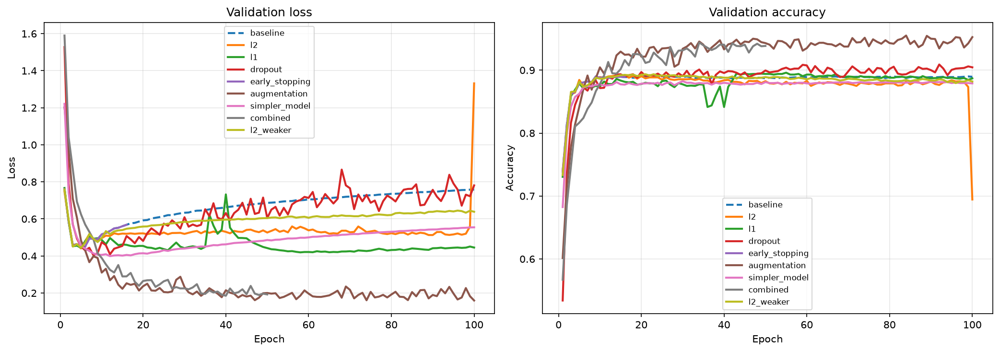
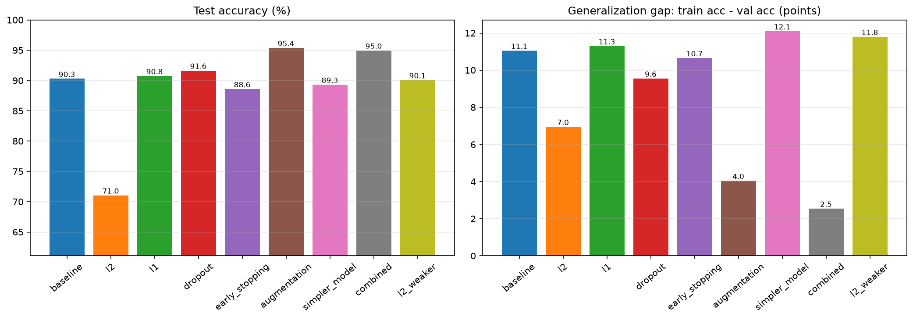
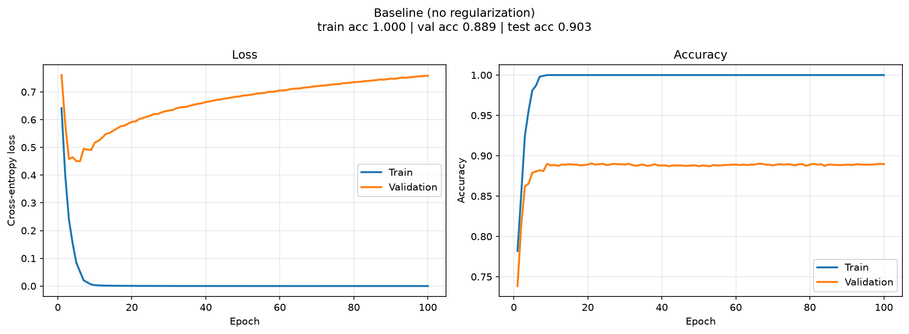

# Overfitting and Regularization Study

A controlled PyTorch experiment that **deliberately overfits** a large MLP on a small MNIST subset, then applies **one regularization remedy at a time** and compares the results against the same baseline.



## Table of Contents
- [Overview](#overview)
- [Project Structure](#project-structure)
- [Requirements](#requirements)
- [Installation](#installation)
- [How to Run](#how-to-run)
- [Experiments](#experiments)
- [Results](#results)
- [Key Observations](#key-observations)
- [Conclusion](#conclusion)
- [Future Work](#future-work)

## Overview
Overfitting happens when a model memorizes the training data instead of learning patterns that generalize. This project:

1. Trains a large MLP on only 1,000 MNIST images (baseline) so that it overfits.
2. Applies six remedies **individually**: L2, L1, Dropout, Early Stopping, Data Augmentation, Simpler Architecture.
3. Trains one **combined** model using the best ideas together.
4. Saves training/validation curves, comparison plots, a metrics table and raw histories.

**Fair comparison:** in every run the data split, random seed (so identical initial weights), optimizer, learning rate, batch size and max epochs are the same. Only the remedy under test changes.

## Project Structure
```
Overfitting/
├── main.py                # Full experiment: data, model, training, plots
├── requirements.txt       # Python dependencies
├── README.md              # Project documentation
├── data/                  # MNIST (auto-downloaded on first run)
├── plots/                 # Generated figures
│   ├── 00_baseline.png
│   ├── 01_l2.png
│   ├── 02_l1.png
│   ├── 03_dropout.png
│   ├── 04_early_stopping.png
│   ├── 05_augmentation.png
│   ├── 06_simpler_model.png
│   ├── 07_combined.png
│   ├── comparison_validation_curves.png
│   └── comparison_final_metrics.png
└── results/
    ├── metrics.csv        # Final metrics of all experiments
    └── histories.json     # Per-epoch loss/accuracy histories
```
`data/`, `plots/` and `results/` are created automatically when you run the script.

## Requirements
**System**
- Python 3.9 or newer
- About 100 MB of free disk space (MNIST download + outputs)
- Internet connection on the first run (to download MNIST)
- GPU is optional; the project runs on CPU in a few minutes

**Python packages** (see `requirements.txt`)

| Package | Minimum version | Purpose |
|---|---|---|
| torch | 2.0 | Model and training |
| torchvision | 0.15 | MNIST dataset and augmentation |
| numpy | 1.21 | Numerical operations |
| pandas | 1.3 | Metrics table and CSV export |
| matplotlib | 3.5 | Plots |

## Installation
**1. Clone the repository**
```bash
git clone https://github.com/faizanjutt473/<repo-name>.git
cd <repo-name>
```

**2. Create and activate a virtual environment**

Windows (PowerShell):
```powershell
python -m venv venv
.\venv\Scripts\Activate.ps1
```
Linux / macOS:
```bash
python3 -m venv venv
source venv/bin/activate
```

**3. Install dependencies**
```bash
pip install -r requirements.txt
```

## How to Run
Run with default settings:
```bash
python main.py
```

Run with custom settings:
```bash
python main.py --epochs 100 --train-size 1000 --seed 42
```

| Argument | Default | Description |
|---|---|---|
| `--seed` | 42 | Random seed (data split and initial weights) |
| `--train-size` | 1000 | Number of training images |
| `--val-size` | 2000 | Number of validation images |
| `--batch-size` | 64 | Mini-batch size |
| `--epochs` | 100 | Maximum epochs |
| `--lr` | 0.001 | Learning rate (Adam) |
| `--patience` | 10 | Early-stopping patience (epochs) |

After the run, check `plots/` for figures and `results/metrics.csv` for the final table. A summary table is also printed in the terminal.

## Experiments
Base model: MLP with hidden layers 512-512-256 (about 798k parameters), Adam optimizer.

| # | Experiment | Change from baseline |
|---|---|---|
| 0 | Baseline | None (expected to overfit) |
| 1 | L2 | Weight decay = 5e-4 |
| 2 | L1 | L1 penalty = 5e-5 on weights |
| 3 | Dropout | p = 0.5 after each hidden layer |
| 4 | Early stopping | Stop when validation loss does not improve for 10 epochs; restore best weights |
| 5 | Augmentation | Random rotation (±15°), shift (10%), scale (0.9–1.1) |
| 6 | Simpler model | Single hidden layer with 64 units (about 51k parameters) |
| 7 | Combined | L2 + Dropout (0.3) + Augmentation + Early stopping |

## Results
Data: 1,000 train, 2,000 validation, 10,000 test images. Seed 42.

| Experiment | Train Acc | Val Acc | Test Acc | Gap (Train − Val) | Epochs Run |
|---|---|---|---|---|---|
| Baseline | 1.000 | 0.8895 | 0.9029 | 0.1105 | 100 |
| L2 | 0.764 | 0.6945 | 0.7105 | 0.0695 | 100 |
| L1 | 1.000 | 0.8870 | 0.9075 | 0.1130 | 100 |
| Dropout | 1.000 | 0.9045 | 0.9165 | 0.0955 | 100 |
| Early Stopping | 0.987 | 0.8805 | 0.8860 | 0.1065 | 16 |
| **Augmentation** | 0.993 | **0.9525** | **0.9538** | 0.0405 | 100 |
| Simpler Model | 1.000 | 0.8790 | 0.8933 | 0.1210 | 100 |
| Combined | 0.966 | 0.9405 | 0.9496 | **0.0255** | 50 |



## Key Observations
1. **The baseline overfits clearly:** 100% training accuracy vs 88.95% validation accuracy.
2. **Data augmentation was the best single remedy** (95.38% test accuracy), since the core problem is the small dataset.
3. **The combined model had the smallest generalization gap** (2.55 points) with 94.96% test accuracy.
4. **L2 with weight decay 5e-4 was too strong** for Adam and caused underfitting (71.05% test accuracy). A smaller value such as 1e-4 or 5e-5 should be tested.
5. **L1 created sparsity** (93.86% of weights near zero) but did not improve generalization.
6. **Dropout** gave a modest gain of about 1.4 points in test accuracy.
7. **Early stopping** halted at epoch 16 and restored the best validation-loss weights; accuracy was slightly lower than the baseline.
8. **A smaller network (51k parameters)** did not reduce overfitting; it still memorized the 1,000 training images.

### Baseline behaviour


## Conclusion
With very little data, increasing data diversity (augmentation) is more effective than only constraining the model. Combining several techniques gives the most stable generalization, but the strength of each regularizer must be tuned carefully, as the L2 result shows.

## Future Work
- Tune L2 strength (1e-4, 5e-5) and L1 strength
- Run multiple seeds and report mean ± standard deviation
- Vary the training set size and plot learning curves
- Try other augmentations and normalization layers (e.g. BatchNorm)

## Author
**Muhammad Faizan Farooq**, Machine Learning & AI Engineer
GitHub: [faizanjutt473](https://github.com/faizanjutt473)